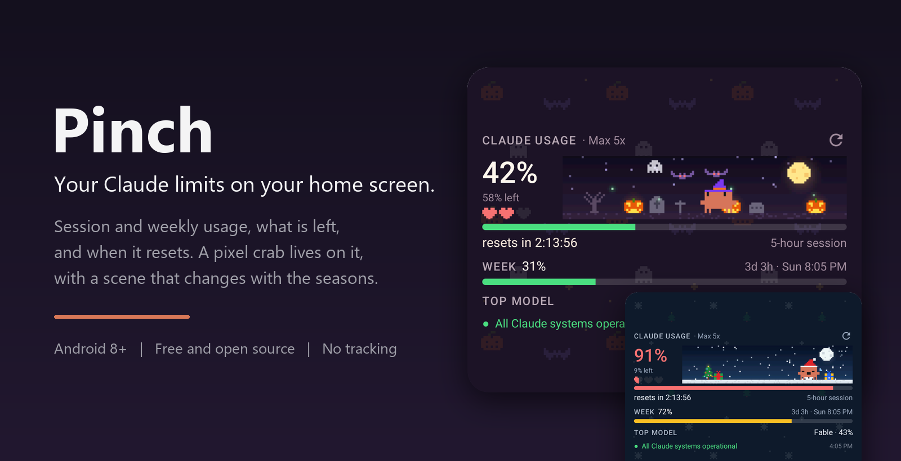
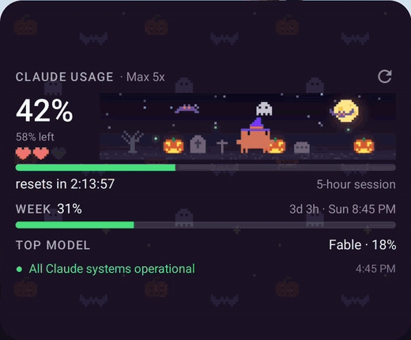
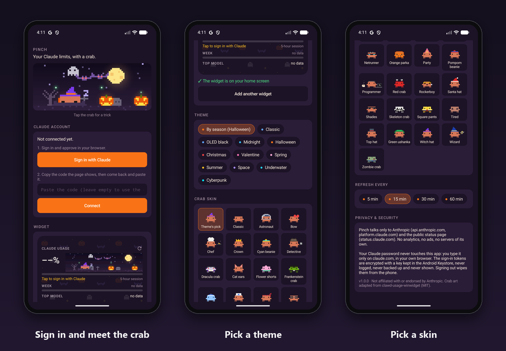
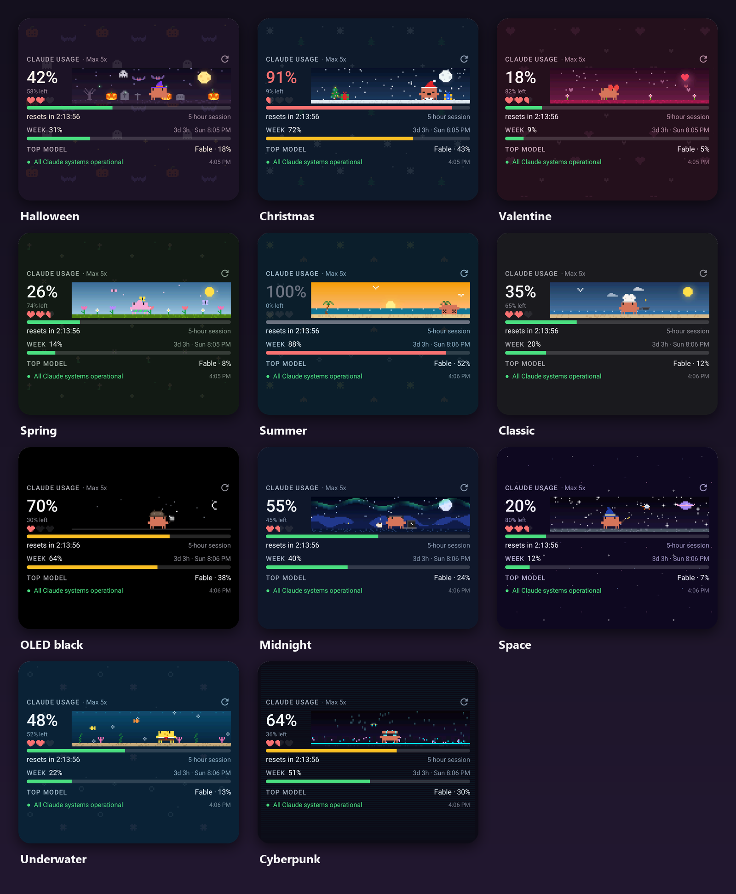

<p align="center"></p>

# Pinch

Pinch is a home screen widget for Android that shows your Claude usage limits. You can see how much of your 5-hour session and your weekly limit you have used, how much is left, and when each one resets.

A small pixel crab lives on the widget. He walks around a little scene, reacts to how much you have used, and changes his look with the seasons.

<p align="center"></p>

[Watch the demo video (MP4)](docs/demo.mp4)

## What the widget shows

- **Session:** how much of the current 5-hour session you have used, how much is left, and a live countdown to the reset.
- **Week:** how much of your weekly limit you have used, and when it resets.
- **Top model:** the model with the highest weekly use, for example Fable or Sonnet.
- **Hearts:** three hearts that empty as your session runs out.
- **Status:** whether Claude is up, from status.claude.com.

The bars turn yellow at 60% and red at 85%.

## Install

You need an Android phone running Android 8 or newer, and a Claude Pro or Max account.

1. On your phone, open the [latest release](https://github.com/YoussefAbdelkawy/Pinch/releases/latest) and download `pinch-1.0.0.apk`.
2. Open the downloaded file. If Android asks, allow your browser to install apps, then tap **Install**.
3. Open **Pinch**.
4. Tap **Sign in with Claude**. Your browser opens the Claude sign-in page.
5. Sign in to Claude and tap **Authorize**. The page shows a code.
6. Copy the code and go back to Pinch.
7. Paste the code in the box and tap **Connect**. If the code is already copied, you can tap **Connect** with the box empty.
8. Tap **Add the widget to the home screen** and place it.

The widget opens at a size that fits everything. If you make it smaller, the bottom rows hide so nothing gets cut off.

<p align="center"></p>

## Settings

You can change these in the app:

- **Theme.** "By season" is the default. It picks Halloween in October, Christmas in December, Valentine in February, Spring from March 20 to May, Summer from June to August, and Classic the rest of the year. You can also pick a theme yourself.
- **Crab skin.** "Theme's pick" dresses the crab for the theme, for example a witch hat at Halloween. There are 31 skins. Four of them come with their own animation:
  - **Chef:** flips a pancake.
  - **Programmer:** types on a laptop next to a cup of coffee.
  - **Wizard:** has a sparkling wand.
  - **Detective:** checks things with a magnifying glass.
- **Refresh every.** Choose 5, 15, 30 or 60 minutes. The 5-minute option only runs while your phone is awake, so it does not drain the battery. Android may stretch it by a few minutes.

To refresh right away, tap the refresh button on the widget. Tap the crab to see a trick.

<p align="center"></p>

## How the crab behaves

| Your session | The crab |
|---|---|
| No session running | Sleeps in the sand |
| Normal use | Walks around, looks around, waves or hops |
| 85% or more | Moves slowly and sweats |
| 100% | Lies on his back |
| Your session resets | Jumps with confetti |

He also moves along the scene as your session fills up, so his position shows your usage at a glance.

## Privacy and security

- **Your password never goes into Pinch.** You only type it on claude.com, in your own browser.
- **Pinch only talks to Anthropic.** It connects to `api.anthropic.com` for your usage, `platform.claude.com` for sign-in, and `status.claude.com` for the public status page. It has no server of its own, no ads and no tracking.
- **Your sign-in is encrypted on your phone.** The key is stored in the Android Keystore, and the token is never logged or backed up. **Sign out** deletes it.
- **The sign-in steps are protected.** The sign-in page opens in your own browser. The code is hidden from screenshots and other apps. The clipboard is cleared after you connect.
- **It asks for very few permissions:** internet access and network state.

For details, see [SECURITY.md](SECURITY.md).

### Antivirus warnings

Some antivirus apps warn about any app that is installed from outside the Play Store. Pinch is open source, so you can read all of its code here. If your antivirus flags it, you can check two things:

1. The APK is signed with this certificate (SHA-256):
   `39:D7:53:0A:8C:27:D9:C9:0A:B5:35:A9:7C:F2:8C:40:D1:BC:E6:5D:EA:88:A7:BC:58:94:63:26:77:6C:DD:52`
2. The file's SHA-256 checksum is listed on the release page.

You can also report the warning to your antivirus as a false positive.

## Where the numbers come from

Pinch asks Anthropic for your usage in the same way Claude Code does for its `/usage` command. Anthropic does not offer a separate public API for this, so this is the most direct source there is.

- The numbers refresh in the background, when you open the app, and when you tap refresh.
- Your sign-in renews itself, so you only sign in once.
- If your phone is offline, the widget keeps the last numbers and says "offline".
- If Anthropic changes the data format, the widget tells you instead of showing old numbers. An app update will fix it.

## Build from source

You need JDK 17 and the Android SDK (platform 34).

```bash
git clone https://github.com/YoussefAbdelkawy/Pinch.git
cd Pinch
./gradlew assembleDebug
./gradlew testDebugUnitTest
```

To build a signed release, create a file called `keystore.properties` in the project folder. Git ignores this file.

```properties
storeFile=/path/to/release.jks
storePassword=your-password
keyAlias=your-alias
keyPassword=your-password
```

Then run `./gradlew assembleRelease`.

Every library the build downloads is checked against a SHA-256 checksum in `gradle/verification-metadata.xml`.

Debug builds have a demo command for taking screenshots. It is not included in release builds:

```bash
adb shell am broadcast -n dev.pinch.app/.DemoReceiver --ei session 42 --ei week 31 --es theme halloween --es skin chef
```

## Credits

Pinch builds on two open source projects under the MIT license:

- [clawd-usage-winwidget](https://github.com/Enhed/clawd-usage-winwidget) by Venger Sergey, for the crab's sprite, his tap animations, the original 27 skins and the theme colors. The crab is Clawd, the mascot of Claude Code.
- [claude-pulse-android](https://github.com/G-biggy/claude-pulse-android), for the sign-in and usage approach.

Pinch is not made by or connected to Anthropic.

## License

MIT. See [LICENSE](LICENSE).
