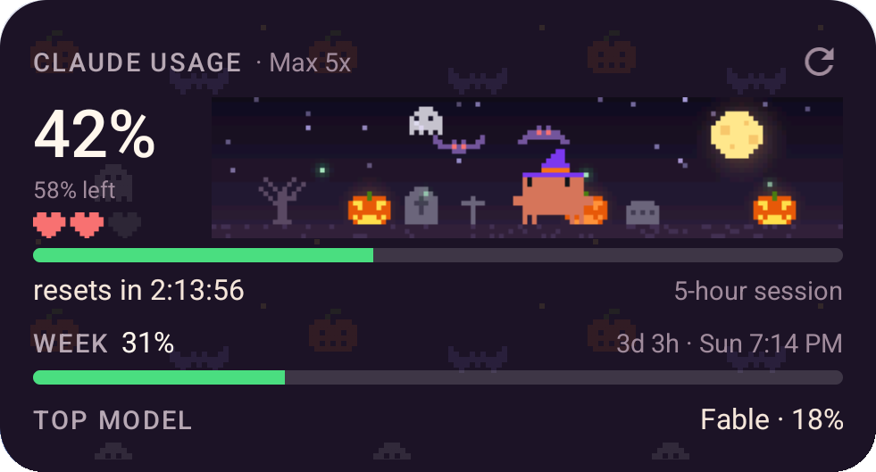
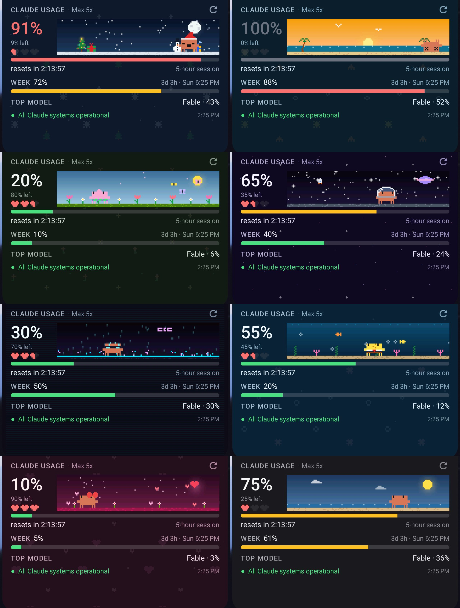

# Pinch

Your Claude limits on your home screen, with a pixel crab who lives on them.

Pinch is an Android widget for Claude Pro and Max. It shows how much of your 5-hour session and your week is left, which model you use most, and whether Claude is up. A crab scuttles around a little animated scene that changes with the seasons. It signs in to your Claude account straight from the phone, with no server in between.

<p align="center">
  
</p>

## What it shows

- **Session**: the 5-hour window, as a big percentage, **what's left**, and a live countdown to the reset
- **Week**: the 7-day limit across all models, and when it resets
- **Top model**: the per-model weekly limit you've used most (Fable, Sonnet, Opus…)
- **The crab's health**: three hearts with halves, one half per ~16.7% of the session left
- **Service status** from status.claude.com, and when the numbers were last fetched
- Bars turn yellow from 60% and red from 85%

## The crab

He lives on a little stage inside the widget. His home spot moves along the stage as your session fills up, and from there he wanders out and back, looks around and does a little hop. Bats, snow, butterflies, fish and clouds really travel across the scene. Everything is one seamless loop, so nothing snaps back.

| Session | The crab |
|---|---|
| No session running | Burrowed in the sand with "z"s; now and then he peeks out |
| Normal | Wanders out and back, looks around, hops, waves or yawns depending on his hearts |
| 85% and up | Short tired shuffles, eyes darting, sweating |
| 100% | Belly-up with X eyes, legs twitching |
| The 5-hour window resets | Jumps for joy with confetti |
| **Tap him** | One of Claude Code's own click animations (jump, spin, peekaboo, wink, boop, turn…) |

The app has a big crab too. Tap him for tricks.

## Themes

**By season** (the default) changes with the calendar:

| Dates | Theme | Scene | The crab wears |
|---|---|---|---|
| Oct 1 – Nov 1 | Halloween | Graveyard, moon, bats, jack-o'-lanterns, a ghost | Witch hat |
| Dec 1 – Jan 6 | Christmas | Snowfall, a tree with blinking lights, a snowman | Santa hat |
| Feb 7 – 15 | Valentine | Floating hearts | Bow |
| Mar 20 – May 31 | Spring | Tulips, daisies, butterflies | Flower shorts |
| Jun – Aug | Summer | Beach, palms, gulls, waves | Shades |
| Rest of the year | Classic | The crab's beach; the sky follows the time of day | — |

You can also pick one: Classic, OLED black, Midnight, Space, Underwater or Cyberpunk. All 27 skins are there too, or let the theme choose.

<p align="center"></p>

## Install

1. Download `pinch-<version>.apk` from [Releases](../../releases/latest) on your phone and open it. Android will ask you to allow installs from your browser; that is normal for apps outside the Play Store.
2. Open **Pinch** → **Sign in with Claude**. Approve in the browser, then copy the code the page shows.
3. Back in the app, tap **Connect**. You can paste the code, or leave the field empty and it reads the clipboard.
4. Tap **Add the widget to the home screen**, or long-press the home screen → Widgets → Pinch. Resize it as you like: smaller sizes hide the extra rows.

Android 8.0 or newer. It refreshes every 15 minutes by default (you can pick 30 or 60). Tap ⟳ on the widget to refresh now.

**Verify the APK.** Release APKs are signed with this certificate (SHA-256):
`39:D7:53:0A:8C:27:D9:C9:0A:B5:35:A9:7C:F2:8C:40:D1:BC:E6:5D:EA:88:A7:BC:58:94:63:26:77:6C:DD:52`.
Check it with `apksigner verify --print-certs pinch-*.apk`.

## Privacy and security

- **Direct to Anthropic.** The app talks only to `api.anthropic.com` (usage), `platform.claude.com` (sign-in) and `status.claude.com` (public status, no credentials). Those hosts are hard-coded in an allow-list, HTTPS-only, with redirects off.
- **Tokens are encrypted** with AES-256-GCM under a key kept in the Android Keystore, which can't be exported. They are never logged, never shown and never leave the phone except to Anthropic.
- **No backups.** Android backup and device-to-device transfer are turned off for the app's data.
- **No user-installed CAs.** The app trusts only the system's certificate authorities, so a certificate added to the phone can't be used to intercept your token.
- **The sign-in code** is protected while you handle it. The field doesn't feed the keyboard's learning or autofill. The screen is hidden from screenshots while the code is on it. The clipboard is cleared after a successful connect.
- **Sign-in is the PKCE "paste the code" flow** Claude Code itself uses, with the state checked, so the phone gets its own session and never borrows your computer's.
- **No analytics, ads, crash reporters or servers of our own.** Permissions: Internet and network state, plus what WorkManager adds for background refreshes (wake lock, reschedule after reboot).
- Widget buttons go to a private receiver; other apps can't trigger them.
- **Sign out** wipes the tokens and cached numbers.

See [SECURITY.md](SECURITY.md) to report a problem.

## Build from source

```bash
git clone <this repo>
cd pinch
./gradlew assembleDebug        # needs JDK 17 and the Android SDK (platform 34)
./gradlew testDebugUnitTest
```

For a signed release, create `keystore.properties` in the repo root (it is git-ignored):

```properties
storeFile=/path/to/release.jks
storePassword=...
keyAlias=...
keyPassword=...
```

then run `./gradlew assembleRelease`.

Debug builds include a demo hook for screenshots, which is not in release builds:
`adb shell am broadcast -n dev.pinch.app/.DemoReceiver --ei session 91 --ei week 72 --es theme christmas`.

`tools/` holds the scripts that generate the wallpaper tiles, level bars and the icon.

## How it works

- `auth/`: PKCE sign-in, token refresh and the Keystore-encrypted store
- `data/`: the HTTPS client (allow-listed), usage parsing and cache, service status
- `art/`: the crab's sprite and animations (ported glyph for glyph from Claude Code via clawd-usage-winwidget), skins, themes and scenes, drawn as logical pixels and scaled crisp
- `art/Stage.kt`: the choreography and compositor. Home-screen widgets can't run animation code, so the widget gets one seamless 8-second loop of composed frames (scene, moving things and crab) that the launcher flips every 100 ms. The resolution is picked to stay inside the launcher's bitmap budget on any screen.
- `widget/`: the widget, its background refresh and its buttons

### Where the numbers come from (and why they don't go stale)

Pinch signs in to **your Claude account** and asks Anthropic for your usage, the same request Claude Code makes for its own `/usage` screen (`GET api.anthropic.com/api/oauth/usage`). Anthropic offers no other, "official" usage API to switch to; this is the one Claude Code itself uses.

The numbers stay fresh on their own:
- They refresh every 15 minutes in the background (or 30 or 60), whenever you open the app, and when you tap ⟳.
- The 5-hour reset countdown ticks live on the widget between refreshes.
- Sign-in renews itself: the access token is refreshed automatically before it expires.
- The parser reads both response shapes Claude Code knows (the `limits` list and the older `five_hour`/`seven_day_*` fields) and merges them, so a field moving from one to the other loses nothing.
- Without a connection the widget keeps the last numbers and says "offline". If Anthropic ever reshapes the response so nothing is recognisable, the widget says so instead of quietly showing old numbers. Claude Code would need the same fix, and an app update brings it.

## Credits

Pinch is built on two MIT-licensed projects, and their notices are kept in [LICENSE](LICENSE):


- The crab's sprite, click animations, skins, theme palettes and the Halloween scene are adapted from [clawd-usage-winwidget](https://github.com/Enhed/clawd-usage-winwidget) by Venger Sergey (MIT). The crab is Clawd, the mascot of Claude Code.
- The sign-in and usage approach is from [claude-pulse-android](https://github.com/G-biggy/claude-pulse-android) (MIT).

## Disclaimer

Not affiliated with, endorsed by or supported by Anthropic. It uses Claude Code's public OAuth client and an undocumented endpoint to read your own account's usage. Use at your own discretion.

MIT licensed; see [LICENSE](LICENSE).
